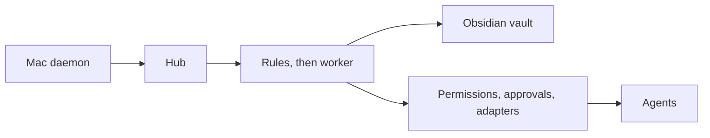

# Agent Hub

[](LICENSE)
[](https://nodejs.org/)
[](.github/workflows/ci.yml)

**Make all your AI agents work as one.** Free, open source and self-hosted.

Most people now use several AI agents, and every one of them starts from zero. You repeat the plan, the constraints and what you already finished, and none of them can hand a piece of work to the one who should do it.

Agent Hub sits in between. It keeps one picture of what you're doing, in an Obsidian vault you own, shares it with your agents limited to the topics you allow, and turns a decision in one conversation into a task for another agent after you approve it.

- **Works with what you already pay for.** It works with no API key and no extra bill. An optional background reader uses Claude Code on your existing plan.
- **Works with agents that have no API,** including ones that only live in iMessage, email or Telegram. That's the part most memory tools don't do.
- **You own it.** Your memory is plain Markdown on your machine, and you can leave any agent without losing what it knew.
- **You stay in charge.** Nothing is handed to another agent without your approval unless you set that up, and each agent only sees what you allow.

## Get started

You need [Node.js 22.13 or newer](https://nodejs.org/). Then:

```bash
git clone https://github.com/Vedthakar/agent-hub.git ~/Code/agent-hub
cd ~/Code/agent-hub
./install.sh
```

It installs everything, starts the hub and opens the setup page. Pick the agents you use, and it walks you through each one. That takes about five minutes for Claude and ChatGPT.

On a Mac, keep it out of Documents and Desktop, since iCloud can move a live database off your disk. On Linux, a server or Windows, use [Docker](#run-with-docker). Everything works there except reading iMessage.

**What you need for each kind of agent:**

| You use | You also need |
| --- | --- |
| Claude, ChatGPT, Gemini | A public address, so they can reach your hub. `npm run tunnel` gets a free one |
| Instinct, Stanley, Boardy (iMessage) | A Mac that stays on, plus Full Disk Access for the helper |
| Sending to Instinct or Boardy by email | A Gmail app password (or another provider's) |
| The background reader | Claude Code signed in with your plan (`claude auth login`) |

Any other agent that speaks MCP or webhooks can be added from **Connections → Add agent**.

### Run with Docker

```bash
docker compose up -d
docker compose logs hub | grep welcome
```

Open the link it prints. Your data stays in a Docker volume.

## What it does

**Seamless context sync.** Claude, ChatGPT, Gemini, and Grok Bot load the shared picture when a chat starts, limited to topics that agent may see. Instinct receives the day's picture by email when a debrief starts. Stanley and Boardy receive a short slice with a task, at the moment they have to act. Last night's plan is waiting in the morning. A study session in Gemini is there when you continue in Claude. Work you finished in Claude is in Instinct's digest, so the debrief starts from what already happened.

**Cross-agent actions.** A decision in one conversation becomes a task for the agent whose job it is. By default you approve it by texting a four-character code (`Y K3FD` or `N K3FD`) before anything is sent.

The default is ask-first. Per-route `notify` and `auto` exist for hand-offs taken from your own messages. Anything an agent proposes still asks. See [Roadmap](#roadmap) for sending those automatically.

## Use cases

### Nightly debrief

**Before.** Instinct asks how the day went. You reconstruct it from memory, including work that happened in other tools.

**With the hub.** When a debrief starts in the Instinct thread, the hub emails Instinct's forwarding address a digest of the day: what other agents logged, which hand-offs are `sent` or `done`, what is still current, and which goals are still standing.

### Morning handoff

**Before.** You open Claude and retype the plan you made with Instinct the night before.

**With the hub.** The debrief stores tomorrow's plan as situation items that become current in the morning. Claude reads them with `get_situation`. Stanley sees the shoot. The study block stays with Claude, ChatGPT, Gemini, and Instinct.

### Study across tools

**Before.** You study in Gemini or ChatGPT, then open Claude and spend the first messages catching it up.

**With the hub.** The study session is logged, tagged, and given an expiry. Claude and ChatGPT see it the next time they ask for the situation. Boardy, Stanley, and Grok Bot do not see school-tagged items.

### Content

**Before.** "I need to shoot tomorrow" sits in Claude. Stanley finds out when you remember to tell him.

**With the hub.** The hub proposes a script task for Stanley. After you reply `Y` and the code, it is delivered in a separate Telegram chat, with a short context block. It does not appear in your iMessage thread with Stanley.

### Project control

**Before.** "Pause open source for a week" is a sentence in Instinct. Grok Bot keeps going.

**With the hub.** The hub records a situation item that expires in a week and proposes a task for Grok Bot. You approve it. Saying you are resuming early replaces that item and proposes a follow-up task.

### Live situation

**Before.** You tell one agent you are starting a coding assessment. The others still try to pull you into other work.

**With the hub.** "In an assessment until 22:00" is stored with an expiry, in a slot so a later update replaces it. Claude, ChatGPT, Gemini, and Instinct can see it. A school-tagged item stays hidden from Boardy, Stanley, and Grok Bot. When the time passes, it drops off on its own.

### Goals and calendar

**Before.** You move a launch date in Claude, and you mention a bill to Instinct. The old date lingers, and a work agent is the wrong place for a rent reminder.

**With the hub.** A later conversation retires the old goal and records the new one. A finance reminder can be proposed for Instinct. The same reminder aimed at Grok Bot is blocked, including when the model tagged it as work.

### Progress you already made

**Before.** You finished the open-source list in Claude. Instinct still has yesterday's list, and you report the day a second time.

**With the hub.** Claude logs the session. Tonight's digest lists that work under today's activity, the goals still standing, and the status of each hand-off. A goal a later conversation replaces is retired, so the old one drops off the list. A hand-off closes when the agent it was sent to reports `done`, or when you cancel it (`cancel K3FD`, or the dashboard). Finishing the work in Claude updates the shared activity. Closing another agent's task is that second step.

## Supported agents

| Agent | Connects via | Read / write | Notes |
| --- | --- | --- | --- |
| Claude | MCP (OAuth) | `get_situation`, `log_session` / inbox tasks | Pick "Claude" on the consent screen. Needs the [standing instruction](#connect-claude-chatgpt-and-gemini). |
| ChatGPT | MCP (OAuth) | same | Developer-mode connectors run in the web app. They do not run in the mobile app. |
| Gemini | MCP (OAuth) | same | Custom MCP servers need the Spark tier. This server speaks Streamable HTTP. |
| Grok Bot | MCP (static bearer), optional webhook | same MCP tools / inbox | Webhook posts the task code, not the body. Scope is work and open source. |
| Instinct | iMessage read, email write | Daemon reads the thread / email digest and tasks | Forwarding address in `INSTINCT_EMAIL`. All topics. |
| Stanley | iMessage read, Telegram read and write | Daemon reads iMessage; adapter polls Telegram / tasks on Telegram | A separate Telegram chat. Context rides with the task. There is no digest. Content and shoots. |
| Boardy | iMessage read, email write, IMAP read | Daemon and inbox replies / email brief | Sends to `boardy@boardy.ai`. Professional and networking only. |

MCP tools are `get_situation`, `set_situation`, `save_memory`, `retire_memory`, `search_history`, `read_old_chat`, `log_session`, `get_inbox`, `propose_task`, and `update_task`. Each OAuth connection is bound to one agent.

## How it works



The daemon ships new lines from watched iMessage threads. MCP agents push sessions and pull context themselves. An iMessage or Telegram thread is routed after 10 minutes of quiet. A session logged with `log_session` is routed on the next pass.

**Router.** Rules come first, so most items cost nothing. A chat that a rule can't settle goes to the background worker, which writes a short summary, situation updates, durable goals, and any tasks, and sorts the item as memory, task, both, or just a log line. Who sent each line comes from message metadata, not from the text. The transcript and the stored state are wrapped as untrusted data.

**No AI of its own, no API keys.** The hub has no model. The worker is Claude Code in headless mode (`claude -p`), signed in with the Claude plan you already have, with every tool switched off, so it can only reply with text. It's off until you turn it on, and you choose whose chats it may read. Without it, agents still share context through the tools below, you can still text the hub, and a chat is recorded only as having happened. API credentials are stripped from its environment, so it can't turn into a metered bill. It does use your plan's limits, capped at `WORKER_MAX_RUNS_PER_DAY`. If an account hits a limit, conversations wait and the hub texts you once.

**Switching accounts.** Add accounts in **Settings → Background worker**. Each signs in separately (it gets its own `CLAUDE_CONFIG_DIR`), and you pick which one runs. Switching is your choice: the hub doesn't rotate accounts by itself to get around a plan's limits.

**Saving as you chat.** Claude, ChatGPT, Gemini, and Grok Bot save with one short tool call: `set_situation`, `save_memory`, `retire_memory`, `propose_task`, or `log_session`. An agent can't replace or retire what you said yourself.

**Texting the hub.** Fixed formats, no AI, from your own devices only, in the approval thread or the box on **Today**:

```text
now: in an assessment until 22:00
today: applying to fintech backend roles
tomorrow: shoot the launch video at 3 #shoots
goal: launch on Monday #work
forget: launch on Monday
stanley: write a script for the shoot
```

A hand-off you type is your approval, so it goes straight out, except over SMS, where caller ID can be spoofed. `#topic` decides who may see it. Untagged items reach only agents with access to everything.

**Importing your old chats.** New chats save as they go, but old chats can't call tools, so **Settings → Import your old chats** brings them in once:

- **Claude and ChatGPT:** export from the app, then move every file it gives you into `Import/` in your vault. Claude's memory files, projects, pages and cloud routine prompts come in too, and account data like login history is set aside. Every chat is filed under `Library/` right away, with no AI and no tokens. A newer export only adds what changed.
- **Code sessions:** one button reads your Claude Code and Codex sessions on this Mac and keeps checking for new ones, filed by repo. Only your words and the replies come in, not tool output. Anthropic's export only lists when cloud sessions ran, so their transcripts can't be imported.
- **Instinct and Stanley:** one button reads the older messages in those iMessage threads from your Mac, with no export. Each day becomes one note.
- **Sorting:** two background passes. First the worker reads each chat, sampling across the whole thing, and writes a summary. Then a stronger model (`WORKER_ORGANIZE_MODEL`) sees every summary at once and builds one folder tree, like `Library/School/MAT224`, so a project stays together. Index notes link it all, so Obsidian's graph shows real clusters. The folder sets which agents can see a chat. It can still guess wrong: move a note and it stays where you put it, or use **Organize again**.
- **Privacy:** keys pasted into old chats are removed on the way in. A sample of each chat and its summary go to Anthropic for sorting, through your own account.
- **Using them:** agents find old chats with `search_history` and `read_old_chat`, limited by the same topic rules. Imported chats never become tasks or current state, and they stay out of `get_situation`, so they don't slow down new chats.
- **What's old and what's not:** everything is dated, and once sorted, a third pass reads each folder in date order and marks chats current, outdated or finished, with a short "where this stands" summary on the folder's index note. Results put outdated chats last and say what replaced them. Drop a note with "profile" in its name into `Import/` and it becomes the most trusted statement of what's true, so it settles conflicts. Plain `.md` and `.txt` notes in `Import/` get filed like chats.
- **Quick start:** a prompt you can paste into Claude or ChatGPT saves your main goals and preferences right away, using that app's own search. It won't find everything.

**Instinct and your vault.** Instinct can't connect to MCP, but it runs on its own computer with a browser and a mailbox, so it reaches your vault three ways. All are in **Connections → Instinct**, limited to the topics it may see:

- **A private page.** Create a link and text it to Instinct once. It gets a read-only page with what's current, your goals, recent activity, your Library and search. The address is the password, so a new link kills the old one, and each read is logged.
- **Regular emails.** An update goes to its mailbox at `INSTINCT_DIGEST_TIMES` (08:00 and 21:00 by default) and when you start a debrief.
- **Email back.** Instinct emails your address with the subject `vault: your search` for matching notes or `remember: something` to save one. Anything else it sends is shared with your other agents. Mail can fake its sender, so none of this can approve anything, and answers only go to Instinct's own mailbox.

**Where to keep it.** Keep the project outside iCloud-synced folders like Documents and Desktop. iCloud can move a live database off your disk, which stalls the hub. `npm run hub:install` runs the hub in the background so it survives restarts.

**Vault.** Open the vault folder (`VAULT_PATH`, default `.data/vault`, also in Settings) in Obsidian. `Memory/` holds one note per goal, preference, fact, and situation item. Edit a note and agents see the new text; delete it and it's retired. Drop a note in `Inbox/` and the hub files it. `Library/` holds imported chats, `Log/` has a line for each thing an agent did, and `Tasks.md` is a read-only view. Tasks, approvals, and permissions stay in the database, so editing a file can never approve anything. Agents reach memory only through the hub's tools, so their topic limits still apply.

**Situation.** This is short-lived state: what you are doing now, a plan, a temporary pause. Each item expires. If the model leaves the expiry off, the hub keeps it for 24 hours. A slot name (`now:activity`, `plan:2026-11-02`, `pause:open_source`) means a newer item replaces the older one. Tomorrow's plan can stay hidden until morning via `valid_from`. Goals and preferences are separate, and they stay until a later conversation retires them. You can clear a situation item on the dashboard.

**Tasks and approvals.** A task is one instruction for one other agent. Before you are asked, the hub checks that the target exists, that it is not the agent the conversation came from, that the payload is inside that agent's scope, that the same hand-off was not already proposed in the last 24 hours, and that the chain is within 2 hops. The text looks like:

```text
[K3FD] Instinct → Grok Bot: Pause open-source work for 1 week.
OK? Reply "Y K3FD" or "N K3FD" (expires in 12h).
```

Each code approves one hand-off, once. A reply has to include the code. Several codes can share one text. Only messages from your own account count. Five unknown codes in 15 minutes lock approvals. You can approve, reject, or cancel on the dashboard as well. Bursts you took part in start a new chain. Agent-only replies to a hub task inherit its hop count, and anything past hop 2 is blocked.

Delivery uses the adapter for that agent: an MCP inbox, email, or Telegram. The assignee marks the task `done` or `failed` with `update_task`.

## Privacy and security

**On your Mac.** The daemon is the hub's reader of Messages. It opens `~/Library/Messages/chat.db` read-only, and forwards 1:1 threads whose handles are listed in `IMESSAGE_HANDLES`. macOS hides that database behind Full Disk Access, so you grant it to the `node` binary the install script prints. That permission is what makes the file readable. The daemon opens it read-only, so this grant is not a write path into Messages. The first outgoing text, used for approval messages, triggers a separate Automation prompt for Messages. The checkpoint moves forward only after the hub has accepted a batch, so sleep and network drops are caught up rather than skipped.

**Your threads.** Digests and tasks go out on side channels: an MCP inbox, Instinct's or Boardy's email, or a Telegram chat with Stanley that is not your iMessage thread. Approval texts go to the handle, bot, or number you configure for that purpose. Point that at a separate thread, not at an agent's number. `ALLOW_THREAD_FALLBACK=1` is the opt-in that lets an Instinct task fall back into the iMessage thread. It is off.

**Scopes.** Instinct, Claude, ChatGPT, and Gemini see every topic. Stanley's default is content and shoots. Grok Bot's default is work and open source. Boardy sees professional and networking context only. School, health, finances, and personal are denied for Boardy in code, so a dashboard or database edit cannot open them. Untagged items stay with the full-access agents. The same check runs again at delivery, with a keyword scan, so a wrong tag does not leak a denied topic into the payload or the context lines.

**Approvals, injection, hops, pause.** Default autonomy is ask. Agent-suggested hand-offs always ask, even on a route set to `notify` or `auto`. `notify` and `auto` apply to hand-offs taken from your own messages. Text `pause hub` and outbound delivery stops. Text `resume hub` to turn it back on. The dashboard has the same control. Details of the injection wrapping, hop limit, and approval rules are in the sections above. The longer write-up is [THREAT_MODEL.md](THREAT_MODEL.md).

**What goes where.**

| Data | Where |
| --- | --- |
| Messages database | Stays on the Mac. The daemon sends text from watched threads only. |
| Events, situation, goals, tasks, audit log, hashed OAuth tokens | Hub database. Embedded PGlite in `.data/` when `DATABASE_URL` is unset, or your Postgres. |
| Transcript and current state, for the summary | Only if you turn the worker on, and only for the agents you pick: Anthropic, through your own Claude account. |
| Memory notes | Your vault folder, on the machine running the hub. |
| Context an agent can use | The slice its scope allows, when it calls `get_situation` or when you approved a task. |
| Grok webhook, if set | The task code. HMAC-SHA256 when `GROK_WEBHOOK_SECRET` is set. |
| Logs | Message bodies are replaced with their length. |

`/health` without the daemon token returns states only. Error text and counts stay behind `HUB_DAEMON_TOKEN`.

## More on setup

The setup page walks you through this:

1. Create a dashboard password.
2. Pick which agents you use. Mac steps only appear if one of them lives in iMessage.
3. On **Connections**, hook up the rest: copy the MCP URL for Claude / ChatGPT / Gemini, pick Instinct / Stanley / Boardy threads from Messages, generate Grok Bot's webhook.

Secrets you type in the UI are stored encrypted (macOS Keychain on a Mac, Supabase Vault in the cloud, or AES-GCM in the hub database). They are never written to `.env`.

**Today** is the home screen: current situation, today's events by agent, pending approvals with Approve / Deny, and adapter health. It works on a phone. You can still approve by text.

`.env` is optional, for servers and CI. Copy `.env.example` if you want to lock a value from the environment (the dashboard then shows it as “Set in .env”). With `DATABASE_URL` empty, data stays in `.data/`.

The longer walkthrough (Supabase, tunnels, Full Disk Access, lid-closed note) is [docs/setup.md](docs/setup.md).

### Connect Claude, ChatGPT, and Gemini

On each agent's Connections page the hub shows the MCP URL (`$HUB_PUBLIC_URL/mcp`), standing instructions with a copy button, and step-by-step screenshots. Cloud connectors need HTTPS. On the consent screen, choose the agent this connection is for, then hit **Test connection** — it waits for the first `get_situation` call.

- **Claude:** Settings → Connectors → Add custom connector.
- **ChatGPT:** Settings → Apps & Connectors → Advanced → Developer mode → Create connector. Web only.
- **Gemini:** Connected Apps → add a custom MCP server.

Grok Bot gets a generated token and webhook URL on its card. Instinct, Stanley, and Boardy use the thread picker plus their side channel (forwarding email, Telegram login, boardy.ai/agents).

### Smoke tests

`npm run smoke` talks to live services. Every message goes to you, and the script refuses a target that belongs to an agent. `--dry-run` prints what it would do.

```bash
npm run smoke -- --dry-run
npm run smoke -- --only=mcp,email
```

Checks are `mcp`, `email`, `telegram`, and `approval`. It reads `.env`, then `smoke.env` if that file exists.

## Adding an agent

An agent is one file that implements `Adapter`:

```ts
export interface Adapter {
  id: AgentId;
  name: string;
  capabilities: Capabilities; // profile, readVia, deliverVia, canReceiveTasks
  readEvents(ctx: AdapterContext): Promise<number>;
  deliverContext(ctx: AdapterContext, digest: { subject: string; body: string }): Promise<Delivery>;
  triggerTask(ctx: AdapterContext, task: TaskRow, context: string[]): Promise<Delivery>;
  configured(cfg: HubConfig): { ok: boolean; note: string };
}
```

1. Add the id to `AGENT_IDS` in `src/shared/types.ts`.
2. Add `src/hub/adapters/<id>.ts`.
3. Register it in `src/hub/adapters/index.ts`.
4. Give it a default scope in `src/hub/scopes.ts`.

`deliverContext` is for a silent digest. `triggerTask` is the moment the agent has to act. Both should use a side channel. A minimal email adapter:

```ts
import { NO_PULL_READS, composeTaskMessage, notConfigured, type Adapter } from './types.js';

export const acme: Adapter = {
  id: 'acme',
  name: 'Acme',
  capabilities: {
    profile: 'One sentence the worker reads when choosing a target.',
    readVia: 'email',
    deliverVia: 'email',
    canReceiveTasks: true,
  },
  readEvents: NO_PULL_READS,
  async deliverContext(ctx, digest) {
    if (!ctx.transports.email) return notConfigured('email not configured');
    const { messageId } = await ctx.transports.email.send({
      to: 'acme@example.com',
      subject: digest.subject,
      text: digest.body,
    });
    return { ok: true, detail: 'emailed digest', ref: messageId };
  },
  async triggerTask(ctx, task, context) {
    if (!ctx.transports.email) return notConfigured('email not configured');
    const { messageId } = await ctx.transports.email.send({
      to: 'acme@example.com',
      subject: `Task [${task.code}]`,
      text: composeTaskMessage(ctx.cfg.ownerName, 'Acme', task, context),
    });
    return { ok: true, detail: 'emailed task', ref: messageId };
  },
  configured: () => ({ ok: true, note: 'example' }),
};
```

Reads that arrive on their own (the daemon, MCP) use `NO_PULL_READS`. Polling reads, like Stanley's Telegram loop, return how many new messages they stored.

## Roadmap

- **Automatic send for agent-suggested hand-offs on a route you trust.** `ask`, `notify`, and `auto` already exist per route. They apply to hand-offs taken from your own messages. A task an agent proposed still waits for a code.
- **More connectors.** Gemini history import is the next one.
- **Hosted option.** Today each person runs their own hub.
- **A Mac menu-bar app.** Today the daemon is a launchd agent (`com.agenthub.daemon`).

## Built on

Agent Hub borrows from these open-source projects. Thanks to their authors.

| Project | License | How it's used |
| --- | --- | --- |
| [Open Second Brain](https://github.com/itechmeat/open-second-brain) | MIT | Code adapted: atomic note writes and the vault path-escape check, in `src/hub/vaultFs.ts` ([notice](THIRD_PARTY_NOTICES.md)). Idea: Obsidian-compatible Markdown as agent memory. |
| [obsidian-second-brain](https://github.com/eugeniughelbur/obsidian-second-brain) | MIT | Idea only: Crew's one-line-per-job logbook inspired `Log/`. No code copied. |
| [agent-second-brain](https://github.com/smixs/agent-second-brain) | MIT | Idea only: a second brain running on a Claude plan you already have. No code copied. |
| [LifeOS](https://github.com/nbramia/LifeOS) | GPL-3.0 | Idea only: sending one person's work to different engines, with a human queue. No code copied. |
| [ChatGPT_Conversations_To_Markdown](https://github.com/daugaard47/ChatGPT_Conversations_To_Markdown) | MIT | Idea only: one Markdown note per exported chat. No code copied. |
| [fflate](https://github.com/101arrowz/fflate) | MIT | Library: reads export zips without loading their attachments. |
| [yaml](https://github.com/eemeli/yaml) | ISC | Library: note frontmatter. |

## Disclaimer

Agent Hub is not affiliated with Anthropic, OpenAI, Google, the projects above, Instinct, Stanley, Boardy, or Grok Bot. Those products can change how they connect, and a connector that works today can need a new setup later.

## Contributing

Issues and pull requests are welcome, especially new agent connectors. See [CONTRIBUTING.md](CONTRIBUTING.md). To report a security problem privately, see [SECURITY.md](SECURITY.md).

## License

[MIT](LICENSE)

## Author

Ved Thakar
